# 拾光（Glimmer）4.2.3

拾光是一款面向 Android 的倒数日、生日与纪念日应用。它把日子整理成安静的纸笺、月历和桌面小组件，让重要时刻能被看见，也能被系统提醒与日历同步照顾到。

当前源码为 `4.2.3 / versionCode=28`，修复列表小组件加载与新增保存时的锁等待，正在准备正式发布；见 [修复与验证记录](docs/releases/v4.2.3-development.md)。公开版本 `4.2.2 / versionCode=27` 已于 2026-10-21 发布，详见 [发布说明](docs/releases/v4.2.2-release-notes.md)、[4.2.2 历史清单](docs/releases/v4.2.2-checklist.md)和[升级验收](docs/releases/v4.2.2-upgrade-acceptance.md)。

**唯一正式发布渠道：GitHub Release。** 本版唯一官方资产为 Direct APK `glimmer-countdown-4-2-3.apk`，沿用正式签名，可保留数据覆盖升级。Play flavor 仅保留用于兼容性与开发回归。

最新公开版本为 `4.2.2`：[下载 v4.2.2 APK](https://github.com/Francesco502/glimmer-countdown-app/releases/tag/v4.2.2)

4.2.3 用户测试包已在 vivo X Fold3 Pro（Android 16 / OriginOS 6）覆盖安装通过，小组件显示和新增保存正常。最终发布构建、云端回归及下载复验以[本版检查清单](docs/RELEASE_CHECKLIST.md)为准。

折叠屏切换、其他手机、完整桌面日期/时区矩阵及系统图片备份恢复尚未验收；本版保留 targetSdk 36。

## 4.2.1 历史版本与截图

以下 4.2.1 截图和签名证据属于历史版本，不作为 4.2.3 验收证据。[4.2.1 历史清单](docs/releases/v4.2.1-checklist.md)、[v4.2 历史清单](docs/releases/v4.2-checklist.md)、[v4.1 历史清单](docs/releases/v4.1-checklist.md)与[v4.0 历史清单](docs/releases/v4.0-checklist.md)保留各版证据。

## 4.2.1 小组件修复

- 自动文字颜色随夜间背景同步切换；从手动颜色切回自动后立即更新。
- 列表、空状态与单事件小组件使用同一颜色更新逻辑。
- 手动选择的浅色文字或深色文字保持固定。

## 4.2.1 桌面小组件实测

最终正式 APK 在 API36 模拟器的 Pixel Launcher 中实际绑定列表与单日小组件，完成日间→夜间→日间切换。安装后读回的 APK 与公开资产 SHA-256 一致；这是模拟器证据，实体手机未测。原图与来源见[截图记录](docs/screenshots/4.2.1/README.md)。

| 日间 | 夜间 |
|---|---|
| 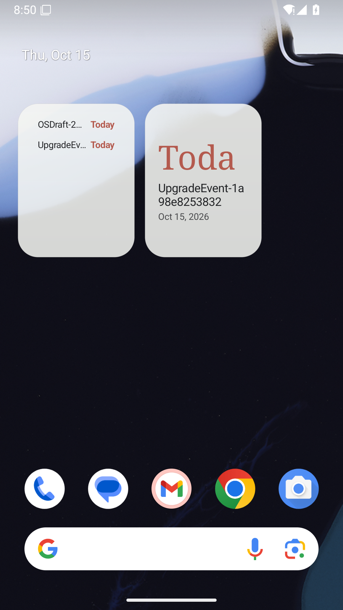 | 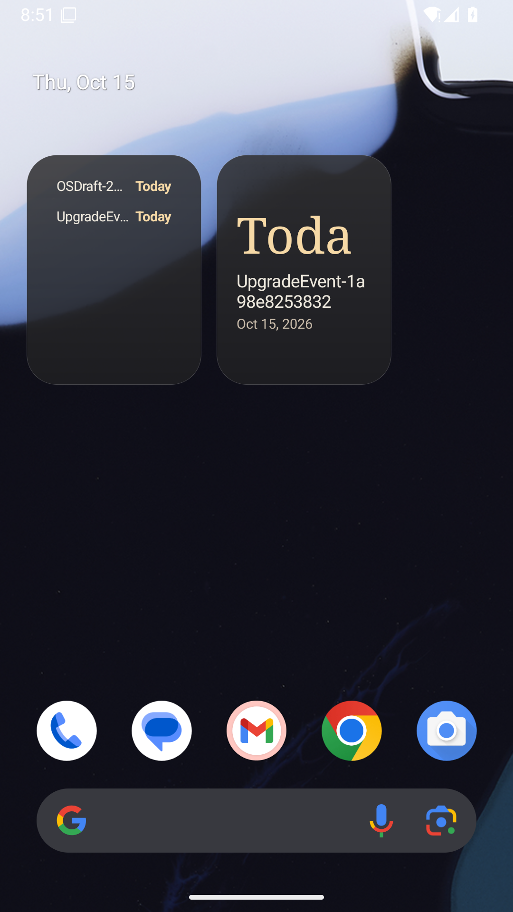 |

## 历史界面预览（v4.2）

以下为 v4.2 历史截图，本轮不将这些截图视为发布证据。截图来自线上正式 APK，按同一最终候选与新鲜构建核验，绑定不可变 `v4.2` 标签。环境为 API36、1080×1920、字体1.0；事件为 QA 夹具，小组件截图是应用内预览。原图来源、哈希与验证范围见[截图记录](docs/screenshots/4.2/README.md)。

| 首页 | 月历 |
|---|---|
| 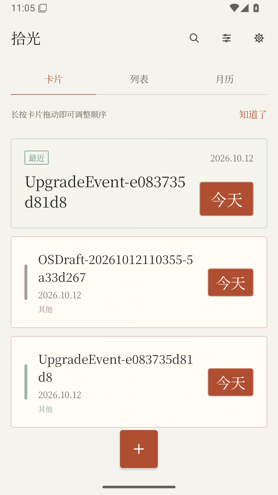 | 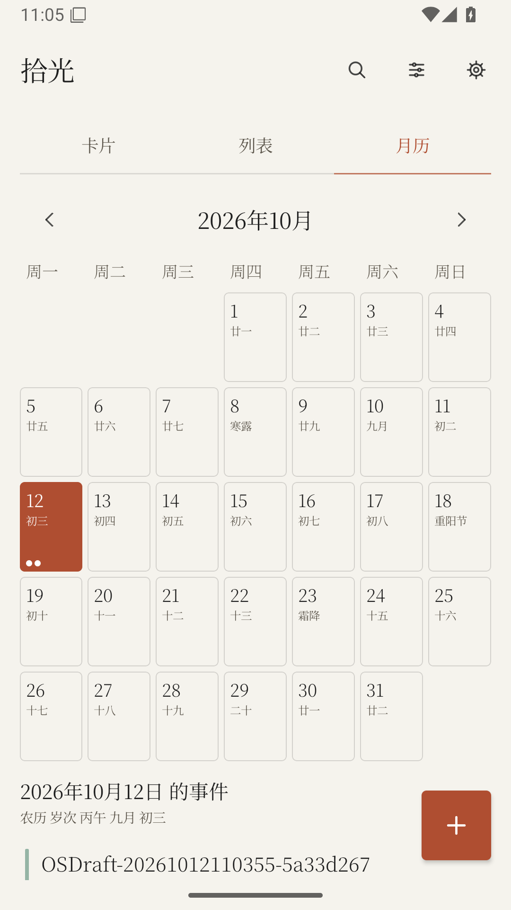 |

| 详情 | 设置 |
|---|---|
| 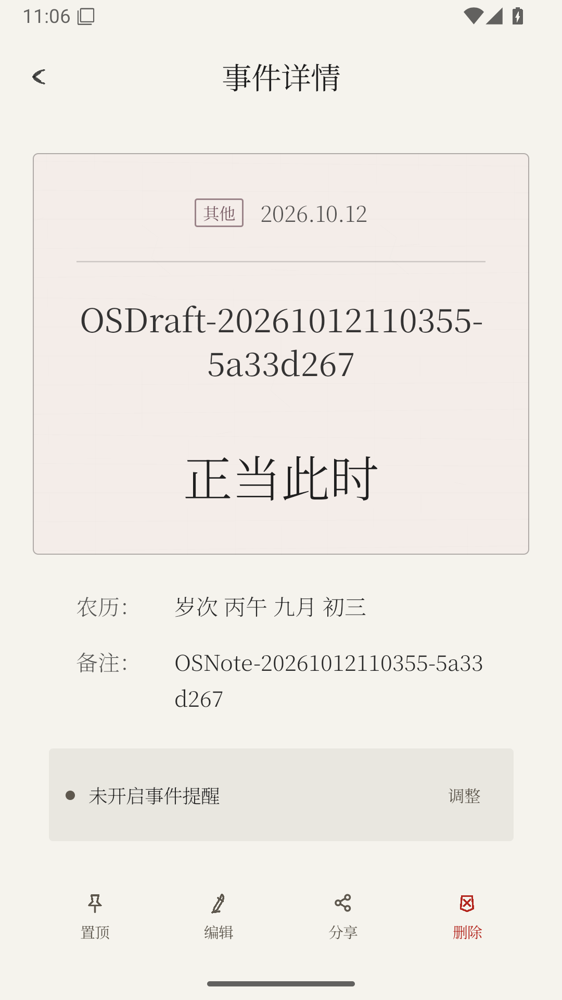 | 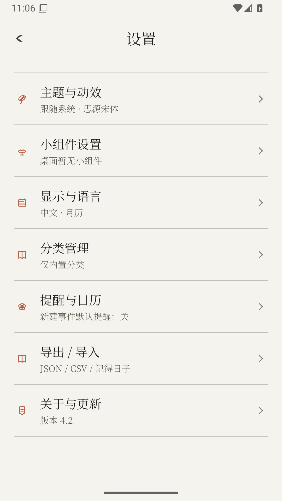 |

| 应用内小组件预览 | 分享预览 |
|---|---|
| 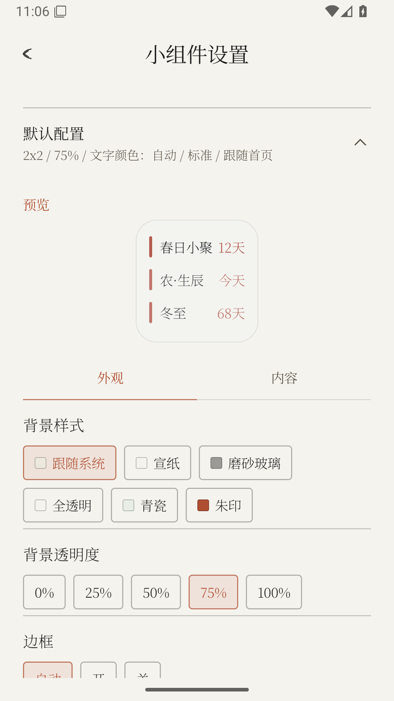 | 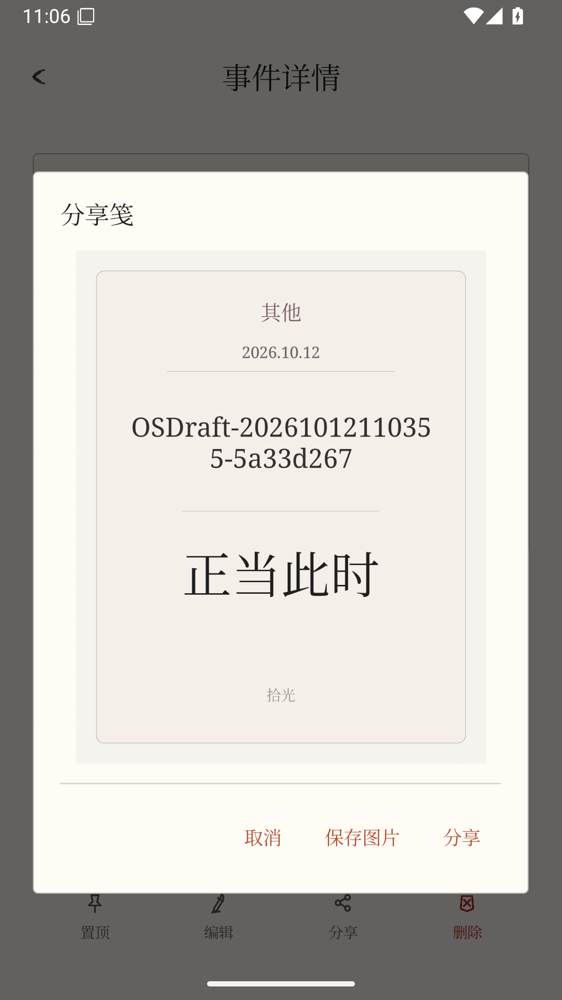 |

## 历史界面预览（v4.1）

以下 `docs/screenshots/4.1` 图片是 v4.1 历史截图，来自线上 v4.1 正式 APK，按当时同一最终候选与新鲜构建核验，绑定不可变 `v4.1` 标签；本轮不将这些截图视为 4.2 发布证据，4.2 截图见上一节。环境为 API36、411dp、字体1.0；事件为 QA 夹具，小组件截图是应用内预览。原图来源、哈希与验证范围见[截图记录](docs/screenshots/4.1/README.md)。

| 首页 | 月历 |
|---|---|
| 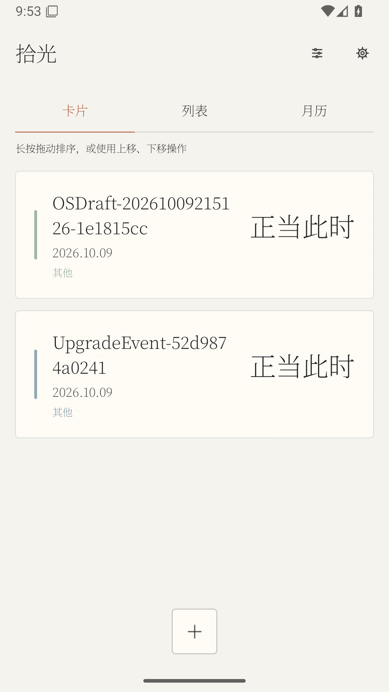 | 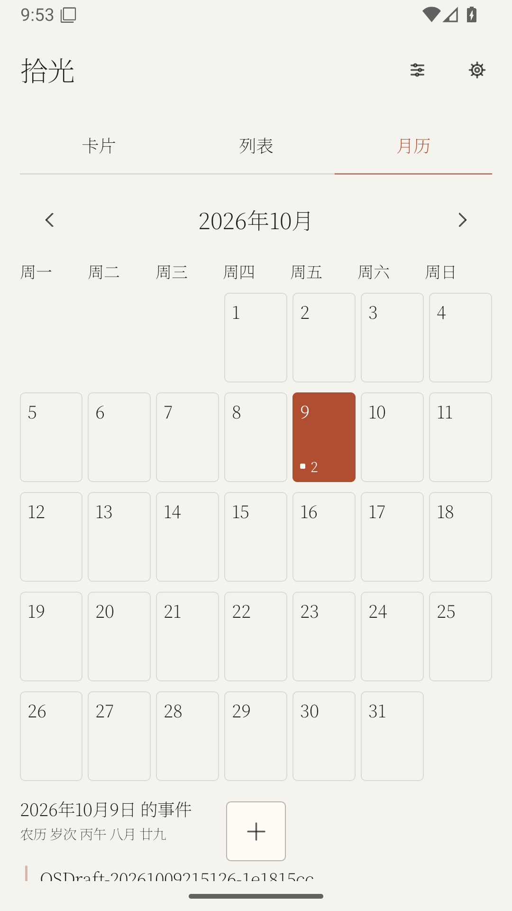 |

| 详情 | 设置 |
|---|---|
| 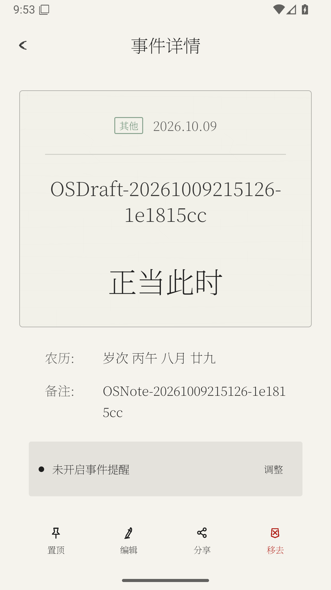 | 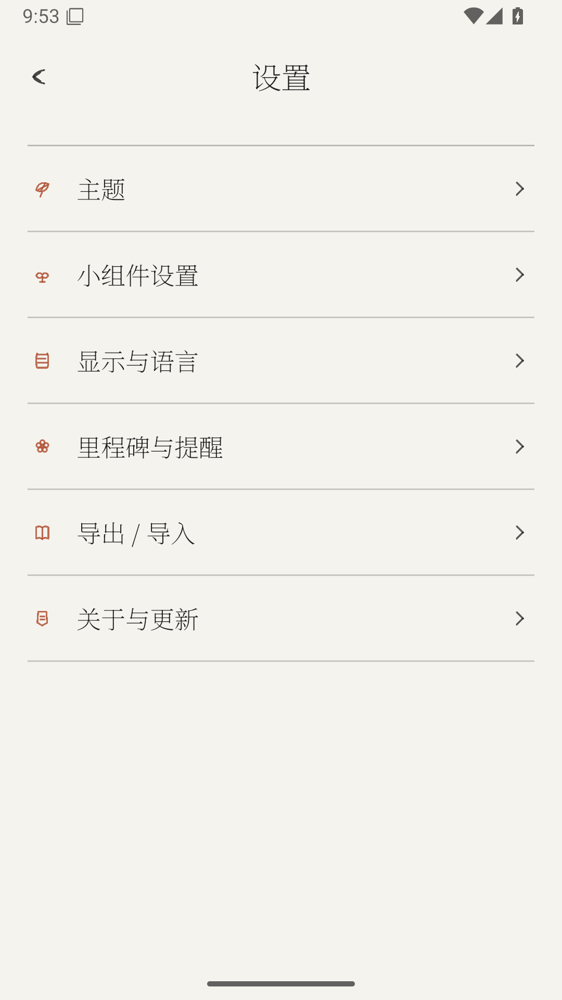 |

| 应用内小组件预览 | 分享预览 |
|---|---|
| 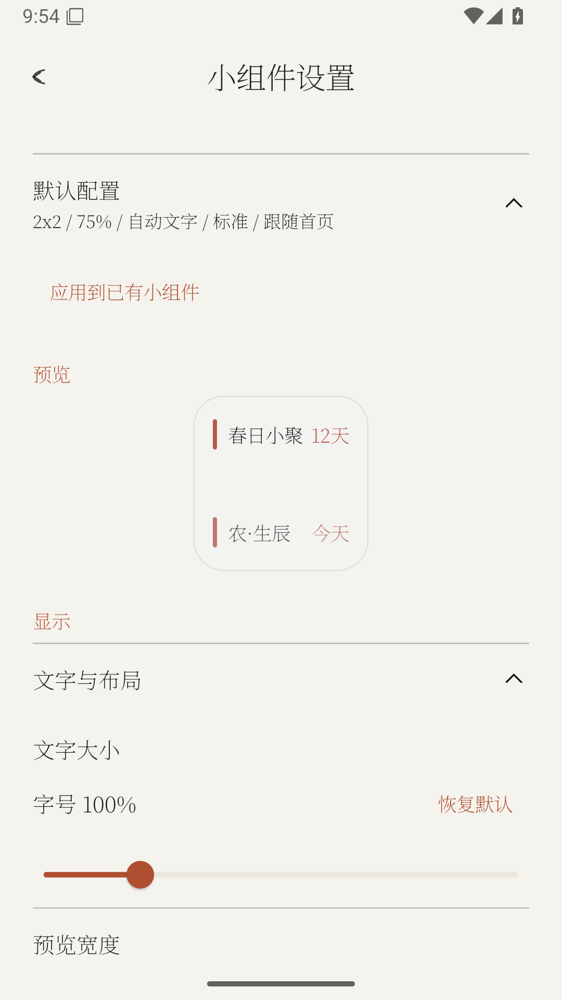 | 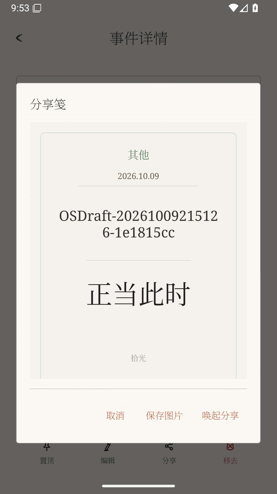 |

## 历史界面预览（v4.0）

以下 `docs/screenshots/4.0` 图片是 v4.0 历史截图，本轮不将这些截图视为发布证据，也不把历史图片标为 4.2 界面。

| 首页纸笺 | 月历视图 |
|---|---|
| 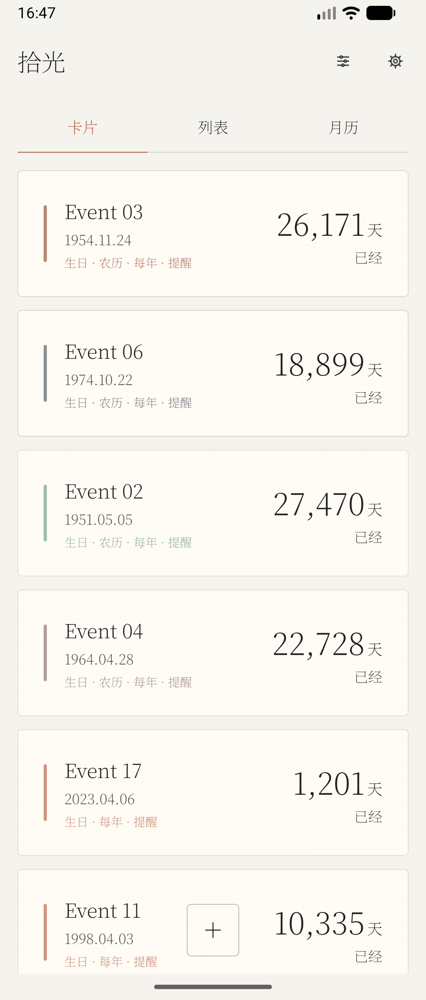 | 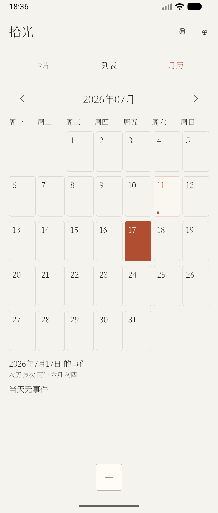 |

| 设置入口 | 小组件设置 |
|---|---|
| 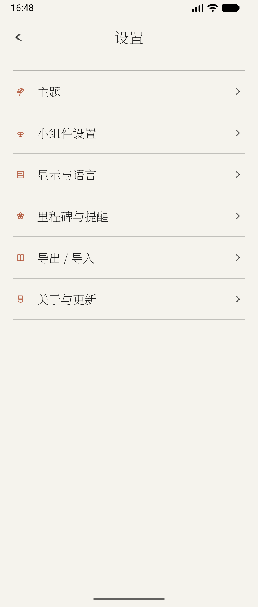 | 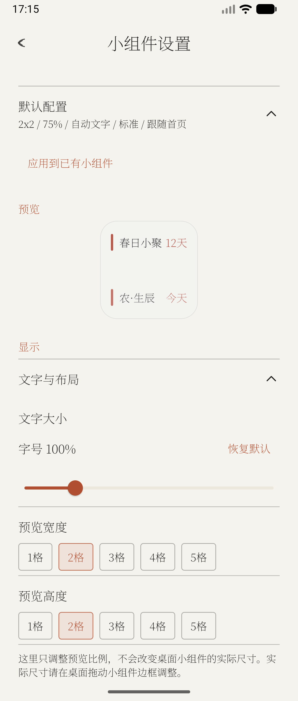 |

## 4.2 体验更新（历史）

- 自定义分类（新建、改名、改色、删除后事件归“其他”，随 JSON 导出导入）与事件配图（系统照片选择器，私有存储，不随 JSON 导出）。
- 单事件大数字桌面小组件；列表小组件预览与桌面一致，设置分“外观 / 内容”两页，保留 1-5 格“预览宽度 / 预览高度”，覆盖已有配置前先确认；深色模式下磨砂玻璃转为深色。
- 首页“最近”横幅（默认开启）、放大的倒数数字、朱印“今天”、置顶标记、顶栏搜索与长按菜单；月历显示农历日、节日与节气，区分今天与选中日，可左右滑动换月。
- 新建页日期紧随标题，提供快捷提醒与常用重复；设置首页每行显示当前值；功能性文案改为直白表述，分享卡与空状态保留宋韵措辞。
- 宽屏（≥840dp）列表与详情双栏、Android 12+ 跟随壁纸取色、Direct 渠道可选精确提醒、更新下载进度与安装权限引导。
- 内置字体裁剪为子集并按 SIL OFL 1.1 改名为 Glimmer Serif / Glimmer Xiaowei，字体资源约 31MB → 7.8MB。

完整变更见 [CHANGELOG.md](CHANGELOG.md)。4.2 按当时评审决定不安排实体手机验收；通知实际到达、精确提醒、物理设备日历、Launcher 小组件、相册选图与长期性能的物理验收记录为未执行。

## v4.1 修复与优化（历史）

- 修复普通事件产生虚假日历权限错误的清理路径，同时保留真实受管日历记录的删除保护。
- 完善编辑草稿恢复、保存任务生命周期、连续输入、导入防重复执行和更新下载完整性。
- 接入 24 小时内小时显示，统一详情页的时间与偏好，明确固定天数纪念节点和周年的区别。
- 改善筛选条件反馈、返回关闭工具面板、排序无障碍、短窗口月历和分享图片的一致性。

## 核心能力

- 记录倒数日、生日、纪念日和普通事件，可自定义分类并添加配图。
- 同时支持公历与农历日期。
- 支持按天、周、月、半年、年重复。
- 支持“提前 N 天 + 固定时间”的提醒配置。
- 支持系统通知（Direct 渠道可选精确提醒）、系统日历同步、权限处理和同步状态反馈。
- 首页提供卡片、列表、月历三种浏览方式，支持搜索、筛选、置顶和自定义排序。
- 桌面列表小组件与单事件大数字小组件；列表小组件支持透明 / 半透明 / 宣纸 / 青瓷 / 朱印等视觉方案，并可配置内容范围、排序、密度、边框、圆角和文字模式。
- 支持 JSON 导入 / 导出，并可导入“记得日子” `.mdb` 备份文件。

## 版本信息

- 当前源码 `versionName`: `4.2.3`
- 当前源码 `versionCode`: `28`
- 发布状态：4.2.3 候选 / 未发布；当前公开版本为 4.2.2
- 4.2.3 Direct Release 正式文件名：`glimmer-countdown-4-2-3.apk`

## 构建与运行

```bash
# Direct 渠道 Debug
./gradlew installDirectDebug

# Play 渠道 Debug
./gradlew installPlayDebug
```

```bash
# Direct 渠道 Release APK
./gradlew assembleDirectRelease

# Play flavor 开发回归（非正式发布门）
./gradlew testPlayDebugUnitTest assemblePlayDebug
```

默认产物路径：

- `app/build/outputs/apk/direct/release/glimmer-countdown-4-2-3.apk`

## 发布与验证

4.2.3 正式发布要求包含，实际结果以当前清单为准：

- `testDirectDebugUnitTest testPlayDebugUnitTest`
- `compileDirectDebugAndroidTestKotlin compilePlayDebugAndroidTestKotlin`
- `lintDirectDebug lintDirectRelease lintPlayRelease lintVitalDirectRelease lintVitalPlayRelease`
- `assembleDirectRelease`，或按[发布指引](docs/release_and_update_guide.md)从最终 tag 的 CI 未签名 Release 工件在本机完成正式签名
- Direct release APK 正式证书、精确证书指纹与 SHA-256 验证
- Direct release APK 的 API26/31/36 模拟器安装、v4.2.2→v4.2.3 保留事件升级、AMS 草稿恢复与 API36 页面、分享、更新 smoke；vivo X Fold3 Pro 覆盖安装、小组件显示与新增保存已获用户确认，其他设备及系统备份恢复未执行
- GitHub Release 只保留 `glimmer-countdown-4-2-3.apk`，并完成公开下载复验、线上重装、更新检查与关键链路 smoke

本版最终标签 CI、正式签名包 API26/31/36 升级与恢复、公开下载和发布后复验正在执行，未完成项目不能标记通过。原始报告、运行时截图与证据范围见当前发布检查清单；历史截图不作为本版证据。

publisher 会拒绝脏工作区或未指向 exact tag 的 `HEAD`，并核对输出元数据与 APK 的真实包名、版本、权限和非调试状态。发布流程禁止移动已推送的 tag 或覆盖已发布 Release，GitHub Release 仅上传 exact Direct APK。

正式发布必须在代码与文档提交且工作区干净后推送不可变 tag，再从该 tag commit 新鲜构建和验证签名、证书指纹、SHA-256；不得复用旧产物。publisher 会删除 owned draft 中的所有旧资产，并要求整个 Release 只保留唯一的 exact Direct APK。本地认证使用 `gh auth login` / 脚本内部 `gh auth token`，CI 才从 secret 注入 `GITHUB_TOKEN`，且不得打印凭据。现有本地认证状态不作为结论；最终发布时按此流程重新取得并验证有效的写入权限。

更多发布记录：

- [CHANGELOG.md](CHANGELOG.md)
- [docs/RELEASE_CHECKLIST.md](docs/RELEASE_CHECKLIST.md)
- [docs/GITHUB_AND_RELEASE.md](docs/GITHUB_AND_RELEASE.md)
- [docs/release_and_update_guide.md](docs/release_and_update_guide.md)
